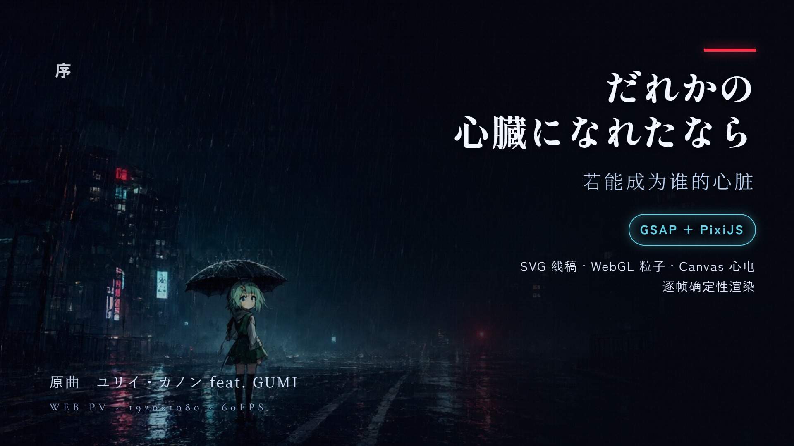
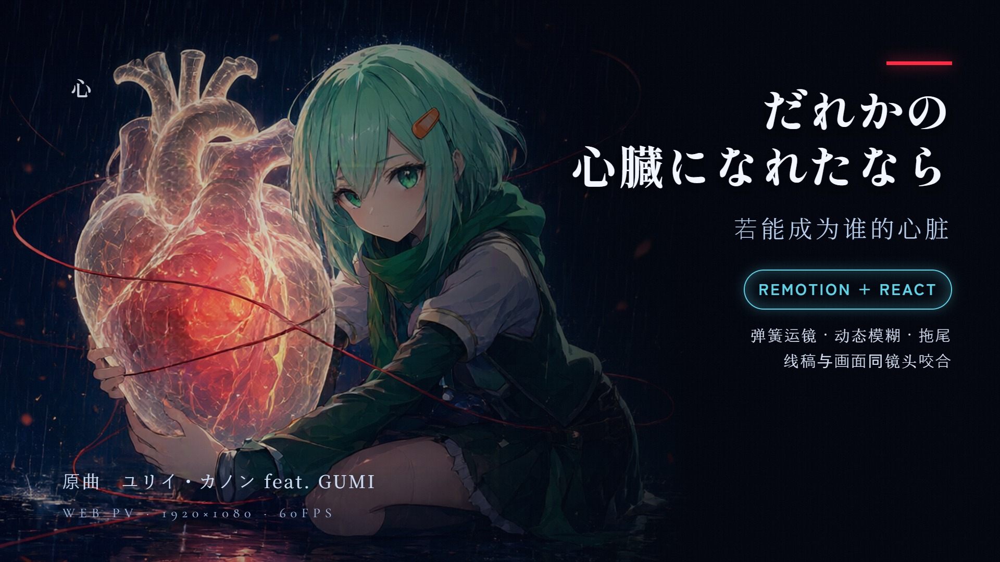
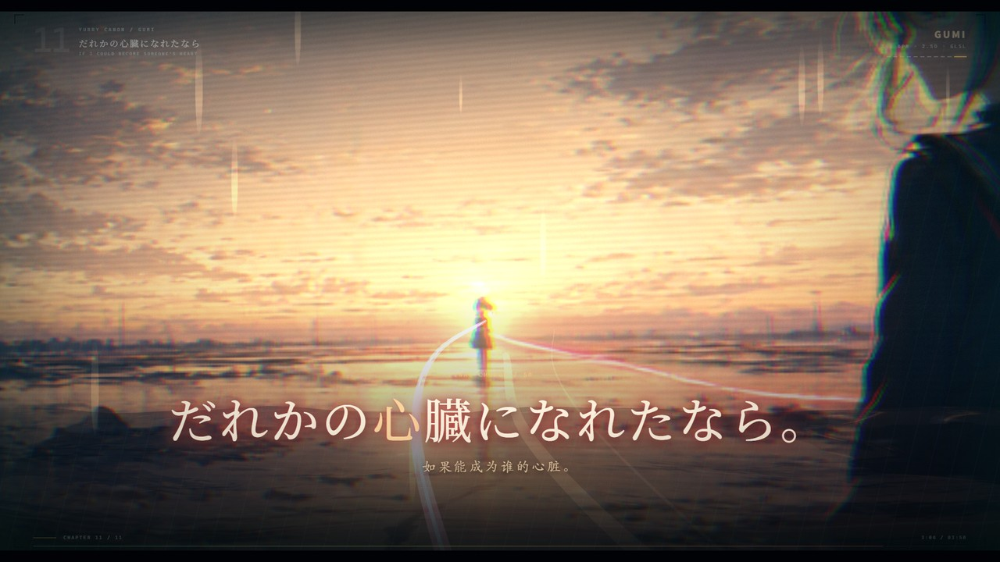
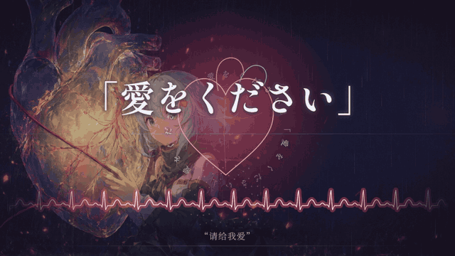
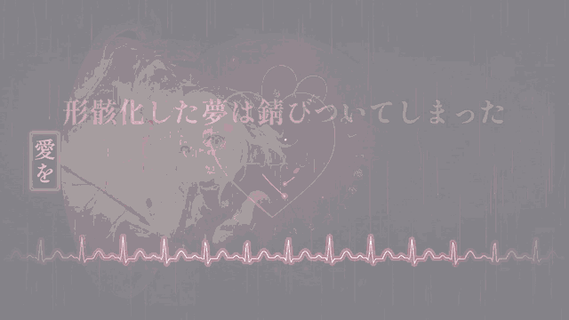

# だれかの心臓になれたなら ／ 若能成为谁的心脏 — Web PV

一个用**网页技术**做的 PV（Promotional Video）：把 ユリイ・カノン 的 **「だれかの心臓になれたなら」feat. GUMI** 做成三支可以实时播放的网页动画，A/B 版各自导出 1920×1080 / 60fps 的视频；C 版是带音频的完整实时 3D 网页版。

本仓库包含**三套互相独立的实现**，用不同技术路线做同一首歌，可以直接对比观感：

| 版本 | 技术栈 | 目录 | 特点 |
|---|---|---|---|
| **A. GSAP 版** | GSAP 时间轴 + PixiJS(WebGL) + Canvas2D + SVG | [`gsap-pv/`](gsap-pv/) | 三层景深雨丝、WebGL 粒子与光斑、SVG 手绘线稿、Canvas 心电图；逐帧截图导出 |
| **B. Remotion 版** | Remotion 4 + React + TypeScript | [`remotion-pv/`](remotion-pv/) | 全部动效改用物理弹簧、镜头动态模糊、文字拖尾、路径生长/流动、图层与背景共用同一套相机 |
| **C. Remotion Player × Three.js 版** | `@remotion/player` + Three.js + GLSL + React | [`remotion-player-pv/`](remotion-player-pv/) | 带原曲音轨的**实时 2.5D / 3D 网页版**：真实透视相机、程序化线框、11 个分镜、逐章跳转；浏览器内实时渲染，不是预渲染视频 |





**副歌片段预览**（「愛をください」，A 版 / GSAP + PixiJS）：



> 更清晰的 12 秒预览：[`preview/gsap_chorus.mp4`](preview/gsap_chorus.mp4)（无声）

**副歌片段预览**（「愛をください」，B 版 / Remotion + React）：



> 更清晰的 12 秒预览：[`preview/remotion_chorus.mp4`](preview/remotion_chorus.mp4)（无声）

**两版同段落对比**（上 = A / GSAP + PixiJS，下 = B / Remotion + React）：

[`preview/compare_chorus.mp4`](preview/compare_chorus.mp4)（无声 · 60fps）


> A/B 两版是**无音频影像版**。C 版是**带原曲音轨的实时演示版**，仅用于非商业同人展示；音乐与歌词权利归原作者与权利方所有，若权利方要求下架会立即移除。

## 🌐 在线直接看

**https://pronoobe.github.io/dareka-no-shinzou-web-pv/**

打开上面的链接即可试玩三版：

- A 版：[`/gsap-pv/`](https://pronoobe.github.io/dareka-no-shinzou-web-pv/gsap-pv/)
- B 版：[`/remotion-pv/`](https://pronoobe.github.io/dareka-no-shinzou-web-pv/remotion-pv/)
- C 版（实时 3D + 音频）：[`/remotion-player-pv/`](https://pronoobe.github.io/dareka-no-shinzou-web-pv/remotion-player-pv/)


---

## 一、原曲

- **曲名**：だれかの心臓になれたなら（若能成为谁的心脏）
- **作者**：ユリイ・カノン（Euryi Canon）
- **演唱**：GUMI（VOCALOID／Megpoid，Internet 公司）
- **主题**：雨夜、扭曲的世界、「请给我爱」的祈求、沉入蓝水的溺落、废弃铁路与病栋、想死的人与想活的人、脆弱的丝线、以及最后"如果我能成为某个人心脏"的愿望。

片中**日文歌词为原文**，底部**中文为译文参考字幕**（译文取自常见通行版本，仅作理解用，非官方译词）。所有权利归原作者与权利方所有。

## 二、怎么运行

A/B 两版都是纯前端、无需构建即可打开（需要一个本地静态服务器，因为有字体与图片的跨源加载）：

```bash
# 在仓库根目录
python -m http.server 8000
# 然后打开
# A 版： http://127.0.0.1:8000/gsap-pv/index.html
# B 版： http://127.0.0.1:8000/remotion-pv/index.html
# C 版： http://127.0.0.1:8000/remotion-player-pv/index.html
```

- **A 版**：打开后自动播放（无音频，按墙钟时间推进），空格键暂停/继续。
- **B 版**：基于 `@remotion/player`，自动播放并循环；底部按钮可暂停/继续，也可用播放器自带控件。
- **C 版**：带音频的实时 Three.js 版本；打开后点击 PLAY，章节栏可跳转。资源路径按当前目录自动计算，在 GitHub Pages 子路径下也能运行。

## 三、目录结构

```
.
├── README.md
├── covers/                     # 三版封面（16:9，B 站风格）
├── gsap-pv/                    # A 版：GSAP + PixiJS
│   ├── index.html
│   ├── src/                    # util / stage / art / lyrics / director / main
│   ├── data/pv.json            # 段落、逐行歌词、逐字时间戳、拍点
│   └── assets/                 # vendor(gsap,pixi) / fonts(子集化 woff2) / img(14 张 AI 画面)
├── remotion-pv/                # B 版：Remotion 导出 + React
│   ├── index.html              # 挂载 @remotion/player
│   ├── player.js               # 打包后的播放器
│   ├── fonts/                  # 同上字体
│   └── img/                    # 压缩后的同一批画面
└── remotion-player-pv/         # C 版：实时 Remotion Player + Three.js（带音频）
    ├── index.html              # 封面 / 章节导航 / 播放器 UI
    ├── app.js                  # Remotion Player + Three.js 构建产物
    ├── styles.css
    └── assets/                 # img（9 张新原画）/ audio（原曲）/ poster
```

## 四、A/B 两版共用的制作基础

**1. 画面素材（AI 绘制）**

14 张场景图全部用本地部署的 **Qwen-Image-2.1**（7B DiT）生成，统一风格提示词，主角统一为 **GUMI**（薄荷绿短发＋橙色发夹＋绿围巾）：
雨夜都市、怪物人群、木偶剧场、发光的解剖心脏、暴雨中撑伞的少女、沉入深水、梦中的重影、雨中的废弃铁路／病栋／送电塔／摩天轮／窗边的花、雨中背靠背的两人、黎明。

**2. 歌词对轴（自动测量）**

1. 用 **demucs** 分离出人声轨；
2. 对每一行歌词**单独**做频谱通量起音检测（自适应阈值、220–2200Hz、最小间隔 0.10s），得到该行实际唱到的音符时刻；
3. 结合 **145.000 BPM** 的节拍网格（由 onset 包络梳状拟合得到，全曲相位稳定）确定每句的起始拍；
4. 把每个字映射到它所属的音符 → 逐字卡拉OK点亮时间戳，即 `data/pv.json` 里的 `k` 数组。

**3. 视觉语法（两版共通）**

- **心跳**贯穿全片：底部一条心电图，QRS 与 145BPM 的每一拍对齐；副歌振幅最大，「死にたい僕は今日も息をして」段出现心律不齐，尾声只剩每两小节一次的濒死搏动。
- **心脏在场门控**：所有"脉冲式"的晃动（切换震动、镜头呼吸、画面脉动）只在心脏元素出现在画面里的时段生效（第一次副歌 54s 起、最终副歌、尾声绽放），前 53 秒画面完全静止。
- **段落运镜**：每张画面按"推入 → 停留并缓慢漂移 → 缓出"三段式运动，且把 GUMI 当作构图焦点——宽画幅时她从上往下缓缓沉，把上方空间让给歌词。
- **歌词排版**：12 种入场方案（居中墨入／升起／坠入／印章砸下／扫光带揭字／散射聚合／RGB 色散／竖排／左滑／角落小字／巨幅副歌／快切列表），逐行指定。

## 五、B 版（Remotion）特有的处理

- **全部动效改用 `spring()`**：镜头推进到位后有真实的过冲与衰减，文字落位是"弹到位"。
- **`<CameraMotionBlur>`**：背景层带 150° 快门角的运动模糊，镜头运动时有真实拖影。
- **`<Trail>`**：副歌巨幅「愛をください」文字带多层光拖尾。
- **`@remotion/paths`**：`evolvePath` 让冠状动脉与血管逐帧生长，`getPointAtLength` 让血流光点沿血管流动。
- **图层咬合**：线稿层以背景层 42% 的推拉、34% 的平移跟随**同一套相机解算**，两层像一台摄影机拍出来的；并按段落给线稿做色彩 grade，使其落在画面光线里。
- **补足的线稿内容**：电线杆与下垂电线（含栖鸟）、霓虹灯牌（心臓／愛を／雨／こんな世界／夢／また会える）、冠状血管＋血流脉冲、玻璃雨、地面积水涟漪、病栋点滴、黎明的候鸟、结尾花瓣、贯穿尾声的丝线。

## 六、C 版（Remotion Player × Three.js）特有的处理

这一版是**独立的实时 3D 网页版**，不是 A/B 的影片导出，也不是播放 MP4。

- **9 张新的本地 AI 原画**：Qwen-Image-2.1 生成，统一 GUMI 角色、雨夜青蓝与绯红配色，分辨率 1024×576。
- **真正的 2.5D 景深**：每张原画是 `THREE.PlaneGeometry` 的纹理，由 `PerspectiveCamera` 做物理推拉、摇移、广角与微距；不是 CSS `transform`。
- **11 个分镜 / 50 句歌词**：按人声分离 + 公开歌词时间轴校准；148 BPM 的脉冲与切换；浏览器内逐字入场。
- **程序化 3D 母题**：心电光带、雨面波纹、四十具棱锥视线、二十面体牢笼、齿轮/提线木偶、星盘时钟、心跳冲击环、几何雨伞、体素剥离、铁轨/输电塔/摩天轮/线框花、双平面撕裂、太阳光球、心形晶壳、跨海红线与光羽。
- **自定义 GLSL**：背景调色与模糊、全息扫描、水面反射、粒子、体积光锥。
- **交互**：封面播放、11 章节跳转、当前镜头与时间码、`?t=181` 秒数深链、全屏/音量/循环。
- **资源路径自适应**：页面自动根据所在目录计算 `/assets`，所以能在 `.../remotion-player-pv/` 子路径下运行。
- **音频**：C 版包含原曲音轨，仅作非商业同人演示。若权利方要求，会立即移除。

## 七、版权与声明

- 音乐、歌词、GUMI 角色形象的权利均属于 **ユリイ・カノン / Internet Co., Ltd. / 各权利方**。本仓库是**非商业的粉丝向视觉演绎**；A/B 版不含音频，C 版为带原曲音轨的实时演示，不用于任何商业用途。
- 仓库中的插画由本地 AI 模型生成，风格致敬原曲气质，不代表官方视觉。
- 如果权利方希望下架，请联系我，会立即删除。

## 八、工具与致谢

GSAP · PixiJS · Remotion · `@remotion/player` · Three.js · GLSL · React · TypeScript · Qwen-Image-2.1（本地推理）· Demucs · Whisper · ffmpeg · Chrome headless · 字体：Shippori Mincho / Noto Serif SC / Zen Kaku Gothic New / Cormorant Garamond（Google Fonts，按用到的字形做了子集化）

感谢 **ユリイ・カノン** 写出这首歌。
